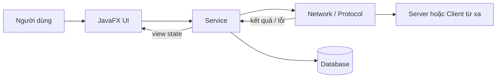

# Kiến trúc chung

## Cấu trúc đã áp dụng

Mỗi lab là một Maven project độc lập:

```text
lapN/
├── pom.xml, mvnw, mvnw.cmd
├── README.md và tài liệu lab
├── scripts/                     # script chạy/demo sau khi chuẩn hóa
└── src/
    ├── main/
    │   ├── java/labN/
    │   │   ├── client/          # khi lab có client protocol riêng
    │   │   ├── server/          # khi lab có server riêng
    │   │   ├── model/ hoặc common/
    │   │   ├── network/ hoặc service/
    │   │   └── ui/
    │   └── resources/{css,icons,fonts,views}/
    └── test/java/labN/
```

Lab 1–4 đã dùng Maven layout này. Package con được giữ ở mức tối thiểu theo vai trò thật của từng bài; không tạo package rỗng chỉ để giống hình thức.

## Trách nhiệm

- `config`: đọc host, port, biến môi trường và giá trị mặc định.
- `model`: dữ liệu thuần; không truy cập UI, socket hoặc database.
- `network`: socket, protocol parser/encoder, request/response và remote connection.
- `service`: use case và điều phối giữa UI, network, database.
- `ui`: JavaFX view/controller, binding và trạng thái hiển thị.
- `test`: kiểm thử protocol, service và luồng tích hợp server–client.



## Nguyên tắc phụ thuộc

- `ui → service → network/db`; không phụ thuộc ngược.
- Không dùng JavaFX type trong `network`, `service` hoặc `model`.
- Không chia sẻ JAR hoặc source giữa các lab; lặp lại một helper nhỏ dễ giải thích tốt hơn tạo coupling giữa bài.
- Network/database chạy trên background executor; chỉ render trên JavaFX Application Thread.
- Resource phải đóng bằng try-with-resources hoặc lifecycle `close()` rõ ràng.

## Trạng thái UI chuẩn

Mỗi thao tác mạng có các trạng thái `idle`, `loading`, `success`, `empty`, `error`, `disconnected`. Service trả kết quả/lỗi; UI quyết định thông báo, skeleton và animation.
