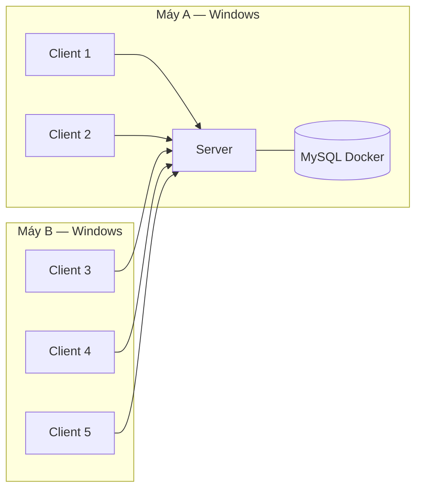
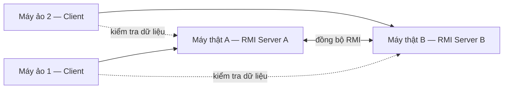

# Sơ đồ và cấu hình demo

## Hai máy cho Lab 1–4

Máy A/B có thể đổi vai. Máy chạy server dùng IPv4 LAN cố định trong buổi demo; client nhập IP đó thay `localhost`. MySQL chỉ bind `127.0.0.1` vì ứng dụng server và database cùng máy.

## Cổng

| Lab | Giao thức | Cổng |
|---|---|---|
| 1 | TCP / UDP file / UDP text | `5000` / `5001` / `5002` |
| 2 | FTP control / PASV | `2121` / `30000-30020` |
| 3 | SMTP / POP3 local | `3025` / `3110` |
| 4 | HTTP | `8080` |

Chạy `configure-firewall.ps1` bằng quyền Administrator trên máy server, profile mạng Windows đặt là Private.

## Bốn máy cho Lab 5

Port registry, remote object và chính sách xung đột sẽ chốt sau khi code Lab 5 được push.

## Checklist trước demo

1. Cả hai máy cùng nhánh/commit và cùng JDK.
2. Chạy `setup-windows.ps1`, sau đó `verify-all.ps1`.
3. Kiểm tra `ipconfig`, `ping`, firewall và `Test-NetConnection` tới port server.
4. Chuẩn bị file nhỏ, media và tài khoản demo; không dùng dữ liệu cá nhân.
5. Mở sẵn terminal server, client, database log và `FEATURE_MAP.md`.
