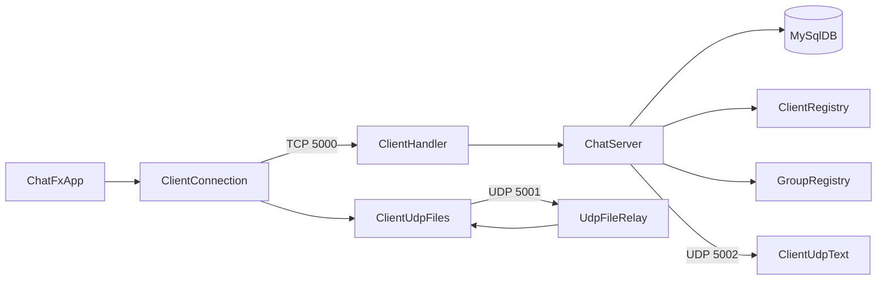

# Kiến trúc Lab 1

## Thành phần

- `ChatFxApp`: giao diện client, lựa chọn người nhận/nhóm và hiển thị sự kiện.
- `ClientConnection`: API client TCP, signaling file và listener nhận sự kiện.
- `ClientUdpText`: nhận multicast/broadcast text.
- `ClientUdpFiles`: chia/ghép gói file và ACK.
- `ChatServer` + `ClientHandler`: nhận kết nối, xác thực và điều phối.
- `ClientRegistry`/`GroupRegistry`: trạng thái online và nhóm trong RAM.
- `UdpTextBroadcaster`/`UdpFileRelay`: phát text và relay file.
- `MySqlDB`: tài khoản người dùng.

## Luồng chính

1. Client mở TCP và đăng nhập; server đăng ký phiên.
2. Server phát danh sách online và catalog nhóm.
3. Chat riêng đi qua TCP; chat nhóm/tất cả được server phát qua UDP.
4. File được báo hiệu bằng TCP, truyền chunk qua UDP và xác nhận ACK/retry.

## Hướng chuẩn hóa sau tài liệu

Giữ nguyên hành vi, sau đó di chuyển về `src/main/java/lab1/{model,network,service,ui}` và `src/test/java/lab1`. Không refactor protocol và UI trong cùng một commit.
