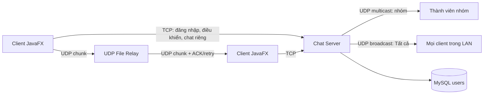
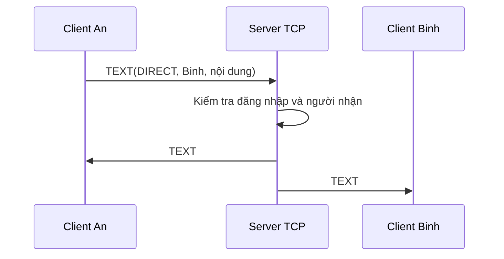
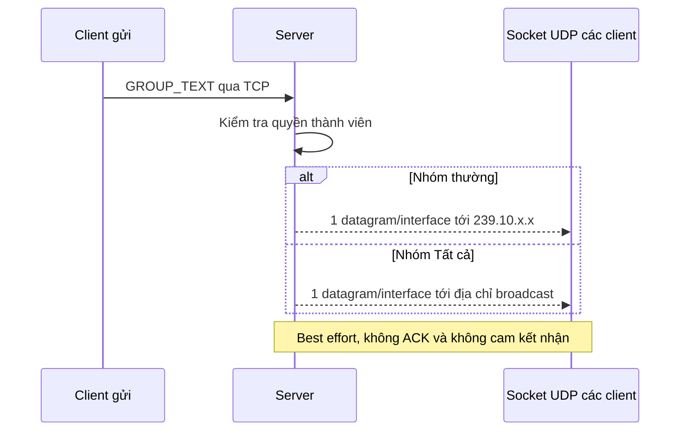
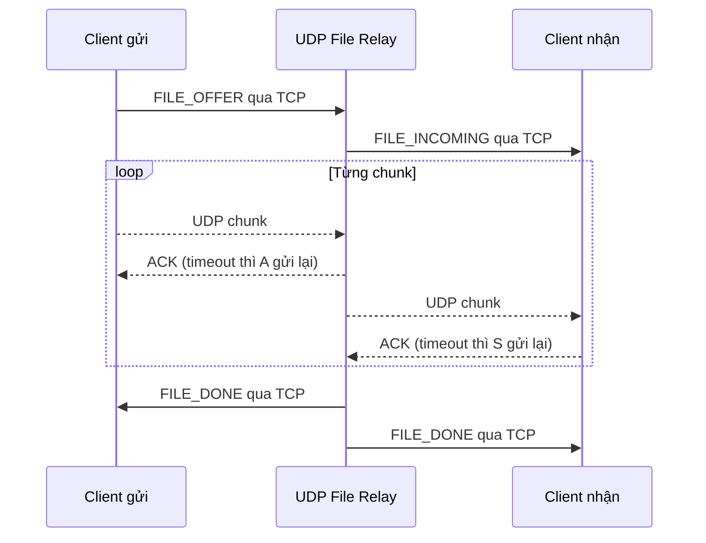

# Lab 1 - Chat Client–Server TCP/UDP

Ứng dụng chat JavaFX cho tối đa 10 client, được thiết kế để trình bày rõ vai trò của TCP và UDP.

## Chức năng theo đề bài

- Giao diện client/server bằng JavaFX, chạy được 5–6 client cùng lúc.
- Chat riêng bằng TCP.
- Chat nhóm bằng UDP multicast thật; mỗi nhóm có địa chỉ `239.10.x.x` riêng.
- Chat “Tất cả” bằng UDP broadcast thật.
- Emoji Unicode; gửi file, audio và video tối đa 20 MB.
- File dùng UDP unicast, chia chunk và có ACK, timeout, retry ở cả hai chặng.
- MySQL chỉ lưu tài khoản. Nhóm và tin nhắn được làm mới khi server khởi động lại.
- Chủ nhóm chọn/sửa thành viên; thành viên có thể rời nhóm.

## Chuẩn bị

- JDK 17 trở lên.
- JavaFX Controls.
- MariaDB/MySQL đang chạy.
- Cập nhật `db.properties` cho đúng `db.url`, `db.name`, `db.user`, `db.password`.
- Cho phép firewall đối với TCP `5000`, UDP text `5002` và UDP file `5001`.

Linux mặc định của project dùng JDK tại `/usr/lib/jvm/java-25-openjdk` và JavaFX tại
`/usr/share/java/java-openjfx`. Có thể đổi các biến ở đầu `run-lap1.sh` nếu máy khác.

## Chạy chương trình

### Linux

```bash
cd lap1
./run-lap1.sh server   # chỉ server
./run-lap1.sh client   # một client
./run-lap1.sh both     # server + một client
./run-lap1.sh demo     # server + 6 client điền sẵn thông tin
```

Với `demo`, lần đầu bấm **Đăng ký** trên sáu cửa sổ; các lần sau bấm **Đăng nhập**.

### Windows PowerShell

```powershell
cd lap1
.\run-server.ps1
.\run-client.ps1
.\run-demo.ps1
```

Script tự tải JavaFX/MySQL Connector nếu thư viện chưa có.

## Kịch bản demo 6 client

1. Mở server và quan sát ba cổng TCP/UDP trên giao diện.
2. Đăng nhập `An`, `Binh`, `Chi`, `Dung`, `Ha`, `Lan`.
3. An chọn Binh và gửi tin riêng: chỉ An/Binh nhận qua TCP.
4. An tạo nhóm, chọn Binh và Chi. Server cấp địa chỉ multicast `239.10.x.x`.
5. An gửi emoji vào nhóm: chỉ An, Binh, Chi nhận UDP multicast.
6. An mở “Tất cả” và gửi tin: sáu client nhận UDP broadcast.
7. Gửi một `.txt`, một file audio và một video nhỏ. Người nhận dùng nút **Mở** để phát bằng ứng dụng hệ thống.
8. Quan sát log server: mỗi thao tác ghi rõ TCP, UDP MULTICAST, UDP BROADCAST hoặc UDP file.

Nếu multicast/broadcast hoạt động trên localhost nhưng không qua LAN, kiểm tra firewall, Wi-Fi client
isolation và bảo đảm các máy nằm cùng subnet. Broadcast không đi qua router.

## Sơ đồ tổng thể



## Luồng chat riêng TCP



## Luồng multicast và broadcast UDP



## Luồng file UDP có độ tin cậy



## Cách giải thích ngắn với giáo viên

- TCP có kết nối, đúng thứ tự và tin cậy nên dùng cho đăng nhập, lệnh điều khiển và chat riêng.
- UDP không bảo đảm giao hàng nên tin nhóm hiển thị “best effort”; đổi lại một datagram multicast có thể đến
  nhiều thành viên và một datagram broadcast có thể đến toàn LAN.
- File không được phép mất byte, vì vậy ứng dụng tự bổ sung số thứ tự chunk, ACK, timeout và retry trên UDP.
- Server giữ quyền xác thực: client không tự phát tin nhóm mà gửi yêu cầu TCP, sau đó server mới phát UDP.

## Kiểm thử

Biên dịch toàn bộ source:

```bash
/usr/lib/jvm/java-25-openjdk/bin/javac --release 17 -encoding UTF-8 \
  --module-path /usr/share/java/java-openjfx --add-modules javafx.controls \
  -cp lib/mysql-connector-j-9.5.0.jar -d out $(find src -name '*.java')
```

Khi MariaDB đang chạy:

```bash
/usr/lib/jvm/java-25-openjdk/bin/java \
  -cp 'out:lib/mysql-connector-j-9.5.0.jar' lab1.test.ChatIntegrationTest
```
