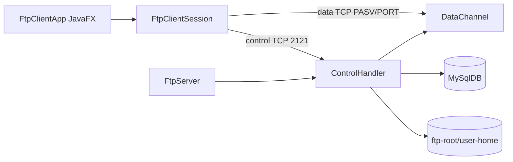

# Kiến trúc Lab 2

## Thành phần

- `FtpClientApp`: UI JavaFX, trạng thái kết nối, progress transfer, toast và thao tác nền.
- `FtpClientSession`: gửi lệnh, đọc reply và mở data connection.
- `FtpServer`: accept control connection, tạo `ControlHandler` trong thread pool.
- `ControlHandler`: state machine phiên FTP và dispatch lệnh.
- `DataChannel`: quản lý PASV/PORT cho đúng một transfer.
- `MySqlDB`: xác thực user và ghi transfer log.

## Luồng upload PASV

1. Client gửi `PASV`; server mở một port trong dải cố định và trả `227`.
2. Client kết nối data socket.
3. Client gửi `STOR filename` trên control channel.
4. Server trả `150`, đọc byte từ data socket, đóng data socket và trả `226`.
5. Server ghi `transfer_logs`.

## Cấu trúc Maven

Source nằm tại `src/main/java/lab2`, CSS tại `src/main/resources/css`, test tại `src/test/java/lab2/test`. `FtpClientSession` không phụ thuộc JavaFX nên integration test kiểm tra protocol độc lập UI.
