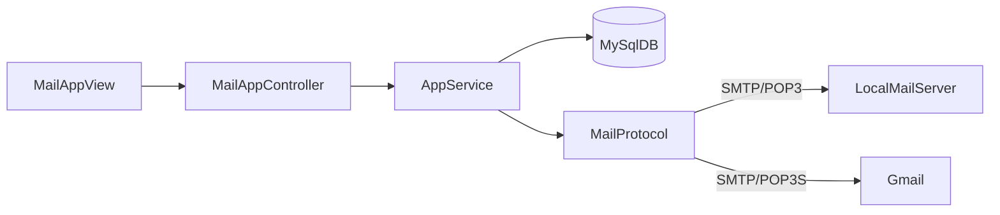

# Kiến trúc Lab 3

## Thành phần

- `MailApp`: khởi tạo JavaFX stage, view, service và controller.
- `MailAppView`: tạo control và phát sự kiện form.
- `MailAppController`: validate luồng UI, chạy `Task` nền và hiển thị kết quả.
- `AppService`: phiên ứng dụng, use case đăng ký/login/gửi/đọc mail.
- `MailProtocol`: cấu hình Jakarta Mail cho SMTP/POP3.
- `LocalMailServer`: GreenMail với hai tài khoản demo.
- `MySqlDB`: user ứng dụng và lịch sử thư gửi.

## Luồng gửi

`MailAppController.handleSend()` → `AppService.sendMail()` → `MailProtocol.sendMail()` → SMTP server; sau khi gửi thành công, `MySqlDB.saveMail()` lưu lịch sử.

## Luồng đọc

`handleRead()` → `AppService.readMails()` → `MailProtocol.readMails()` → POP3/POP3S → `MailAppView.showInbox()`.

## Cấu trúc Maven

Source dùng namespace `lab3.*` tại `src/main/java/lab3`; test tại `src/test/java/lab3`. Jakarta Mail và MySQL không xuất hiện trong view.
