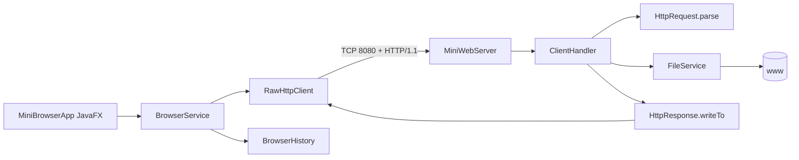

# Kiến trúc Lab 4

## Server

- `MiniWebServer`: bind port, thread pool và lifecycle.
- `ClientHandler`: một connection/một request, dispatch GET/HEAD/POST.
- `HttpRequest`: parse request line, header, content length và path.
- `FileService`: resolve web root, chặn traversal/symlink, lấy MIME và metadata resource.
- `HttpResponse`: status line/header/body, quy tắc HEAD; file tĩnh được stream bằng `InputStream.transferTo()` thay vì nạp toàn bộ vào RAM.

## Client

- `BrowserService`: cửa vào nghiệp vụ; chuẩn hóa URL, gọi HTTP client, quản lý history và lưu file tải xuống.
- `RawHttpClient`: tạo request raw, parse response và trả `Response`.
- `BrowserHistory`: model lịch sử URL trong phiên.
- `MiniBrowserApp`: UI JavaFX chỉ gọi `BrowserService`, quản lý background task và render kết quả.

## Cấu trúc Maven

Source nằm tại `src/main/java/lab4`, CSS tại `src/main/resources/css`, test tại `src/test/java/lab4/test`. `BrowserService`, `RawHttpClient` và integration test không phụ thuộc JavaFX.

Response HTML nhỏ vẫn dùng `byte[]`; PDF/MP3/MP4 và file tĩnh được stream trực tiếp từ file đã kiểm tra vào TCP output stream.
