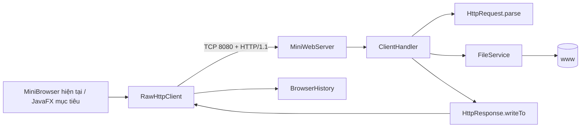

# Kiến trúc Lab 4

## Server

- `MiniWebServer`: bind port, thread pool và lifecycle.
- `ClientHandler`: một connection/một request, dispatch GET/HEAD/POST.
- `HttpRequest`: parse request line, header, content length và path.
- `FileService`: resolve web root, MIME và đọc resource.
- `HttpResponse`: status line/header/body và quy tắc HEAD.

## Client

- `RawHttpClient`: tạo request raw, parse response và trả `Response`.
- `BrowserHistory`: lịch sử URL trong phiên.
- `MiniBrowser`: UI Swing hiện tại; cần thay bằng JavaFX nhưng giữ client độc lập UI.

## Hướng chuẩn hóa

Di chuyển Maven layout và thêm automated integration test trước. Sau đó chuyển UI, rồi cải thiện `FileService` để stream media thay vì giữ toàn bộ byte trong RAM.
