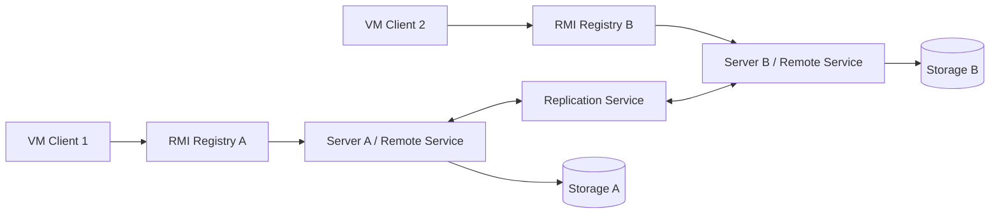

# Kiến trúc Lab 5 — dự kiến

## Ranh giới dự kiến

- `remote`: remote interface, DTO serializable và exception contract.
- `server`: implementation, registry bootstrap và lifecycle.
- `service`: nghiệp vụ, version/xung đột và replication.
- `storage`: dữ liệu độc lập của từng server.
- `client`/`ui`: lookup stub, gọi remote và trạng thái kết nối.

Tên package/class cuối cùng phải theo code thật. Không xây abstraction trước khi review code được push.

## Luồng cần giải thích

Client lookup registry → nhận stub → gọi remote method → server validate/lưu local → replicate sang peer → trả kết quả/version → client cập nhật UI.
