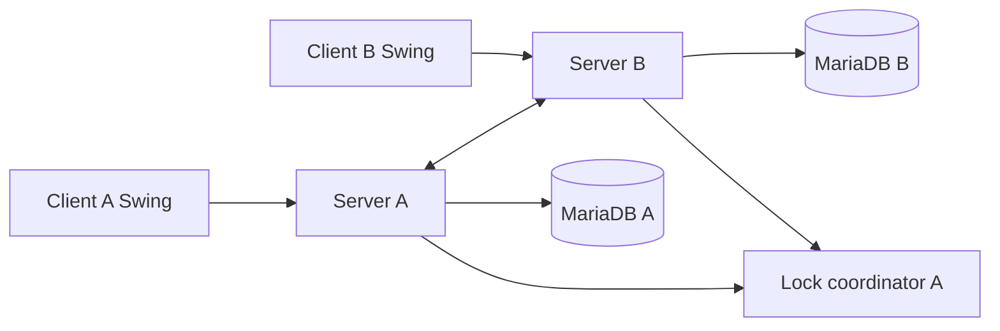

# Kiến trúc Lab 5

Mỗi client Swing gọi RMI WarehouseService và LockService. Hai server lưu MariaDB riêng, gọi SyncService của nhau để đồng bộ trực tiếp. Server A điều phối lock; Server B chuyển tiếp thao tác lock tới A.

Package `common` chứa DTO/model/remote interface; `server.service` điều phối nghiệp vụ; `server.dao` thao tác JDBC; `server.sync` nhận đồng bộ; `server.lock` quản lý lease/fencing; `client.ui` và `server.ui` chứa Swing.

Xem [kiến trúc chi tiết](docs/architecture.md), [contract](PROTOCOL.md) và [giới hạn nhất quán](README.md#10-xử-lý-lỗi-thường-gặp).
