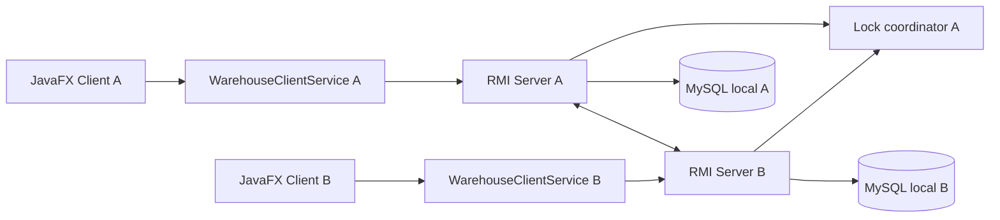

# Kiến trúc Lab 5

Hai JavaFX client chỉ gọi `WarehouseClientService`. Service này chạy RMI và heartbeat ngoài JavaFX Application Thread. Mỗi JavaFX server dashboard gọi `ServerRuntimeService`; runtime quản lý MySQL, RMI Registry, remote object và trạng thái peer.

Luồng ghi là đồng bộ trực tiếp: service nguồn mở transaction, ghi nguồn, gọi `SyncService` của peer, đợi xác nhận rồi mới commit nguồn. Nếu peer báo lỗi hoặc không kết nối được, transaction nguồn rollback. Server A là lock coordinator; Server B dùng `ReconnectingLockService` chuyển tiếp lock tới A.

Các lớp được chia theo trách nhiệm:

- `lab5.config`: đọc cấu hình và kiểm tra địa chỉ mạng.
- `lab5.model`: DTO/model tuần tự hóa, không phụ thuộc JavaFX hoặc JDBC.
- `lab5.network.rmi`: remote contract và RMI client adapter.
- `lab5.db`: pool kết nối và repository chứa toàn bộ SQL.
- `lab5.server.service`, `server.sync`, `server.lock`: nghiệp vụ kho, adapter nhận đồng bộ và lease/fencing.
- `lab5.service`: façade bất đồng bộ cho UI và vòng đời server.
- `lab5.ui.client`, `lab5.ui.server`: JavaFX view, chỉ cập nhật trạng thái UI trên FX thread.

Hai database cùng schema `lab5_warehouse` nhưng nằm trên hai MySQL Server local độc lập. `SyncActivity` chỉ là timeline trong RAM của server UI, không phải outbox.

Giới hạn: đây không phải two-phase commit. Nếu peer đã commit nhưng phản hồi bị mất, nguồn rollback nhưng peer không thể tự rollback; phải dừng ghi và đối soát thủ công.
